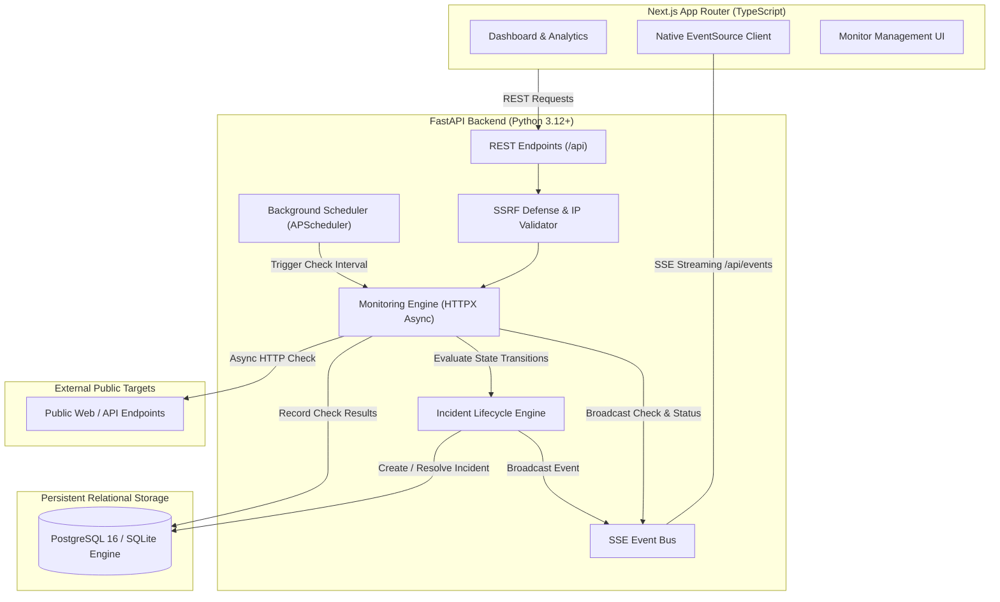

# PULSEWATCH

> **"Know When Your Services Stop. Before Your Users Do."**

PULSEWATCH is a production-grade website and HTTP/REST API monitoring platform and lightweight observability suite. Designed for engineering teams and developers, it provides automated health checks, microsecond latency profiling, automatic incident lifecycle management, historical uptime analytics, and live Server-Sent Events (SSE) streaming updates across a unified dashboard.

---

## Architecture Overview



---

## Key Features

### 1. Robust Asynchronous Monitoring Engine
- **Non-Overlapping Execution**: Prevents task pileup by locking concurrent checks per monitor.
- **Precision Latency Profiling**: Uses high-resolution monotonic clocks (`time.perf_counter()`) to measure sub-millisecond response durations.
- **Three-Tier Health Classification**:
  - `UP`: Returns expected status codes within acceptable latency.
  - `DEGRADED`: Responds successfully but latency exceeds configured threshold (e.g. `> 1000ms`).
  - `DOWN`: Connection timeout, DNS failure, connection refused, or unexpected HTTP status code.
- **Configurable Flexibility**: Customizable intervals (15s to 15m), timeouts (1s to 60s), expected code ranges (`200-399` or `200,201,204`), and methods (`GET` or `HEAD`).

### 2. Zero-Trust SSRF Defense Architecture
- **Protocol Enforcement**: Strictly allows only `http://` and `https://` schemes.
- **Internal & Private IP Blocking**: Validates all resolved IPv4 and IPv6 addresses against private network subnets (RFC 1918: `10.0.0.0/8`, `172.16.0.0/12`, `192.168.0.0/16`), loopback (`127.0.0.0/8`, `::1`), link-local (`169.254.0.0/16`), carrier-grade NAT, and broadcast.
- **Cloud Metadata Protection**: Blocks access to AWS, GCP, and Azure metadata endpoints (`169.254.169.254`, `metadata.google.internal`).
- **Redirect Revalidation**: Inspects every HTTP redirect hop before making the subsequent request.
- **Payload Size Capping**: Limits response body downloads to 5MB to prevent memory exhaustion DoS attacks.

### 3. Automated Incident Lifecycle Management
- **Zero-Noise Incident Generation**: When a monitor transitions to `DOWN`, an incident is automatically opened in the `INVESTIGATING` state.
- **Deduped Alerts**: Repeated consecutive failed checks do not generate duplicate incidents for an ongoing outage.
- **Automatic Recovery & Downtime Calculation**: When the service recovers, the active incident is marked `RESOLVED`, downtime seconds are computed from timestamps, and a recovery event is dispatched.
- **Lifecycle Progression**: Supports progression through `INVESTIGATING` → `IDENTIFIED` → `MONITORING` → `RESOLVED` with custom notes.

### 4. Real-Time Streaming via Server-Sent Events (SSE)
- High-efficiency SSE stream at `GET /api/events`.
- Events:
  - `monitor.created`, `monitor.updated`, `monitor.deleted`
  - `monitor.status_changed`
  - `monitor.check_completed`
  - `incident.created`, `incident.resolved`
- Native `EventSource` client with automatic reconnection and exponential backoff.
- Dashboard views update dynamically in real time without manual browser refreshes.

### 5. Historical Availability & Performance Analytics
- Aggregated uptime calculations:
  $$\text{Availability} = \left(\frac{\text{Successful Checks}}{\text{Total Completed Checks}}\right) \times 100$$
- Visual latency percentiles (average, min, max, p95).
- Time-series buckets for 24-hour, 7-day, and 30-day views.
- HTTP response code distribution (200, 301, 404, 500, etc.).

---

## Technology Stack

| Layer | Technologies |
|---|---|
| **Frontend** | Next.js 14 (App Router), TypeScript (Strict), Tailwind CSS, Lucide React, Recharts, Native EventSource |
| **Backend** | Python 3.12+, FastAPI, Pydantic v2, SQLAlchemy 2.0 (Async), HTTPX, APScheduler |
| **Database** | PostgreSQL 16 (Production) / SQLite Async (Development & Zero-Config Local Testing), Alembic Migrations |
| **Infrastructure** | Docker, Docker Compose, GitHub Actions CI |

---

## Quick Start Guide

### Option 1: Run with Docker Compose (Recommended)

1. Clone the repository:
   ```bash
   git clone https://github.com/your-username/pulsewatch.git
   cd pulsewatch
   ```

2. Copy the example environment file:
   ```bash
   cp .env.example .env
   ```

3. Launch all services:
   ```bash
   docker compose up --build
   ```

4. Access the applications:
   - **Frontend Dashboard**: [http://localhost:3000](http://localhost:3000)
   - **Backend API & Swagger Docs**: [http://localhost:8000/docs](http://localhost:8000/docs)
   - **Health Check**: [http://localhost:8000/api/health](http://localhost:8000/api/health)

---

### Option 2: Run Locally (Without Docker)

#### Prerequisites
- Python 3.12+
- Node.js 20+

#### 1. Backend Setup
```bash
cd backend

# Create and activate virtual environment
python -m venv .venv
source .venv/bin/activate  # On Windows: .venv\Scripts\activate

# Install dependencies
pip install -r requirements.txt

# Run database migrations
alembic upgrade head

# Start FastAPI server
uvicorn backend.app.main:app --reload --host 127.0.0.1 --port 8000
```

#### 2. Frontend Setup
```bash
cd frontend

# Install dependencies
npm install

# Run development server
npm run dev
```

Open [http://localhost:3000](http://localhost:3000) in your browser.

---

## Running Automated Tests

### Backend Test Suite (Pytest)
The test suite validates SSRF protection, health endpoints, monitor lifecycle, status evaluation, incident generation, analytics calculations, and the SSE event bus:

```bash
cd backend
pytest -v
```

All 13 automated tests run against an isolated test database with simulated HTTP mocking and monotonic timer assertions.

---

## REST API Specification

| Method | Endpoint | Description |
|---|---|---|
| `GET` | `/api/health` | Service health, DB ping, and scheduler status |
| `GET` | `/api/monitors` | List monitors with filtering (`search`, `status`, `enabled`) |
| `POST` | `/api/monitors` | Create a new monitor with SSRF validation |
| `GET` | `/api/monitors/{id}` | Retrieve monitor details and 24h uptime |
| `PATCH` | `/api/monitors/{id}` | Update monitor configuration |
| `DELETE` | `/api/monitors/{id}` | Remove monitor and cancel scheduled checks |
| `POST` | `/api/monitors/{id}/check` | Trigger an immediate manual check |
| `POST` | `/api/monitors/{id}/pause` | Suspend scheduled checks for monitor |
| `POST` | `/api/monitors/{id}/resume` | Resume scheduled checks for monitor |
| `GET` | `/api/monitors/{id}/checks` | Retrieve recent check results (paginated) |
| `GET` | `/api/monitors/{id}/analytics`| Retrieve uptime and latency metrics (`24h`, `7d`, `30d`) |
| `GET` | `/api/incidents` | List incidents with filtering (`monitor_id`, `status`, `is_active`) |
| `GET` | `/api/incidents/{id}` | Retrieve incident details |
| `PATCH` | `/api/incidents/{id}` | Update incident status or investigation notes |
| `GET` | `/api/activity` | Retrieve platform audit activity log |
| `GET` | `/api/dashboard/summary` | Global counts, uptime, latency, and incident metrics |
| `GET` | `/api/dashboard/analytics` | Aggregated multi-monitor charts and distributions |
| `GET` | `/api/events` | Server-Sent Events stream for live dashboard updates |

Interactive OpenAPI documentation is accessible at `http://localhost:8000/docs`.

---

## Database Schema

```
monitors
├── id (PK)
├── name (VARCHAR)
├── url (VARCHAR)
├── method (VARCHAR, GET/HEAD)
├── check_interval (INTEGER)
├── timeout (INTEGER)
├── expected_status_codes (VARCHAR)
├── degraded_threshold_ms (INTEGER)
├── enabled (BOOLEAN)
├── current_status (VARCHAR, UP/DEGRADED/DOWN/PENDING)
├── last_checked_at (TIMESTAMP WITH TZ)
├── created_at (TIMESTAMP WITH TZ)
└── updated_at (TIMESTAMP WITH TZ)

check_results
├── id (PK)
├── monitor_id (FK -> monitors.id ON DELETE CASCADE)
├── status (VARCHAR, UP/DEGRADED/DOWN)
├── http_status_code (INTEGER)
├── response_time_ms (FLOAT)
├── error_message (TEXT)
└── checked_at (TIMESTAMP WITH TZ)

incidents
├── id (PK)
├── monitor_id (FK -> monitors.id ON DELETE CASCADE)
├── title (VARCHAR)
├── description (TEXT)
├── status (VARCHAR, INVESTIGATING/IDENTIFIED/MONITORING/RESOLVED)
├── started_at (TIMESTAMP WITH TZ)
├── resolved_at (TIMESTAMP WITH TZ)
├── downtime_seconds (FLOAT)
├── created_at (TIMESTAMP WITH TZ)
└── updated_at (TIMESTAMP WITH TZ)

activity_logs
├── id (PK)
├── event_type (VARCHAR)
├── monitor_id (FK -> monitors.id ON DELETE SET NULL)
├── description (TEXT)
├── metadata_json (TEXT)
└── created_at (TIMESTAMP WITH TZ)
```

---

## Security Model & Limitations

### SSRF Protection
- All URLs are parsed, scheme-checked, and resolved via DNS before any socket connection is opened.
- Requests to loopback addresses, local network interfaces, internal subnets, and cloud instance metadata services are rejected with HTTP 400.
- Redirects are validated hop-by-hop before following.
- In controlled staging or private environments, set `ALLOW_LOCAL_TARGETS=true` only if explicitly required.

### Sampling Limitation Disclosure
Uptime metrics represent discrete sampling intervals (e.g. once per 60 seconds) rather than continuous millisecond-level telemetry. An outage lasting less than the configured check interval may not be captured.

---

## License
MIT License. Created for the 30 Days 30 Projects engineering challenge.
